<div align="center">



<a href="https://www.vijender.me"></a>
<a href="https://drive.google.com/file/d/14bq2wU2y8iiyw4WgjxHer44nFjLG-Nx2/view?usp=sharing"></a>
<a href="https://linkedin.com/in/vijender-yadav-iiit"></a>
<a href="https://twitter.com/vij_yadav_viju_"></a>
<a href="https://leetcode.com/vij_yadav_viju_"></a>
<a href="mailto:ragnarviju2004@gmail.com"></a>

</div>

<br/>

### `$ ls ~/projects --recent`

<p align="center">
  <a href="https://github.com/desmond009/Scam-shield"></a>
  <a href="https://github.com/desmond009/Zipp"></a>
  <a href="https://github.com/desmond009/RingLeader"></a>
  <a href="https://github.com/desmond009/Trust-Trail"></a>
  <a href="https://github.com/desmond009/QueueCTL"></a>
  <a href="https://github.com/desmond009/OrcaEarn"></a>
</p>

<p align="center"><sub>
  <code>live →</code>
  <a href="https://ring-leader-bice.vercel.app">ringleader</a> ·
  <a href="https://staking-contract-orca.vercel.app">orcaearn</a> ·
  <a href="https://minilink-phi.vercel.app">minilink</a> ·
  <a href="https://sol-faucet-beta.vercel.app">sol_faucet</a> &nbsp;|&nbsp;
  <a href="https://github.com/desmond009?tab=repositories">ls -a ~/projects</a>
</sub></p>

<br/>

### `$ cat ~/.stack.toml`



<br/>

### `$ git log --graph`



<br/>

### `$ gh stats --user desmond009`

<div align="center">


<br/>


</div>

<br/>

### `$ exit`

<div align="center">

```console
logout · Building something in fintech, AI agents or Web3? My inbox is open.
```


</div>
