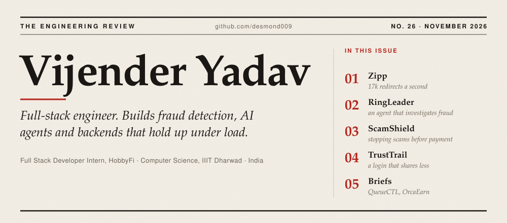
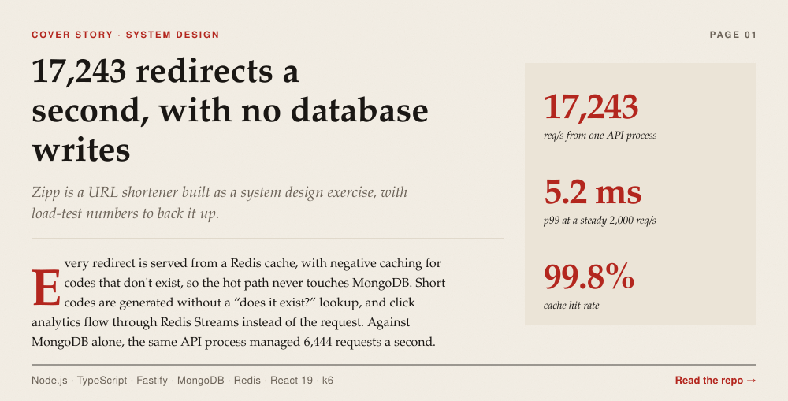
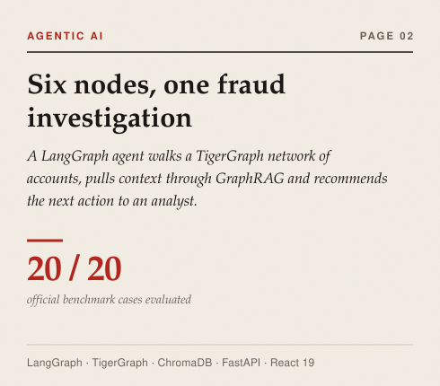
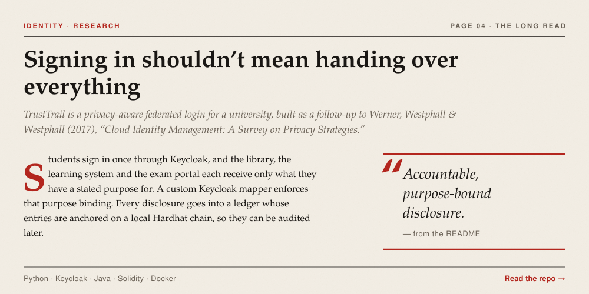
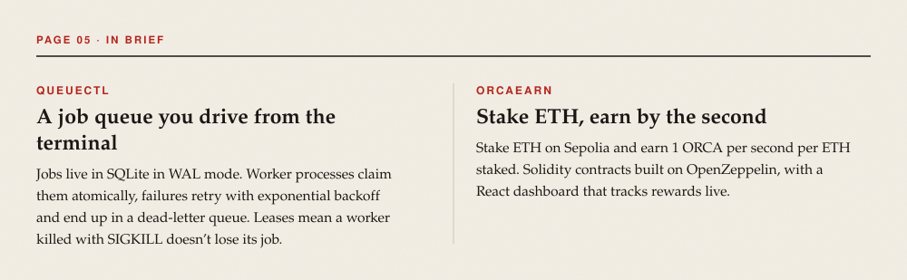
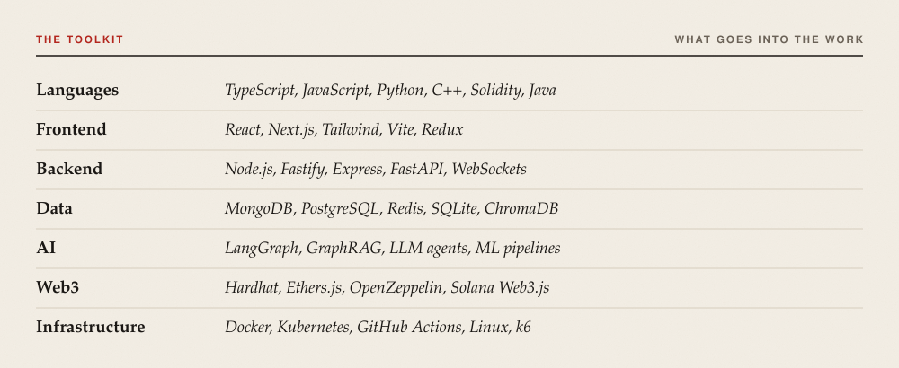
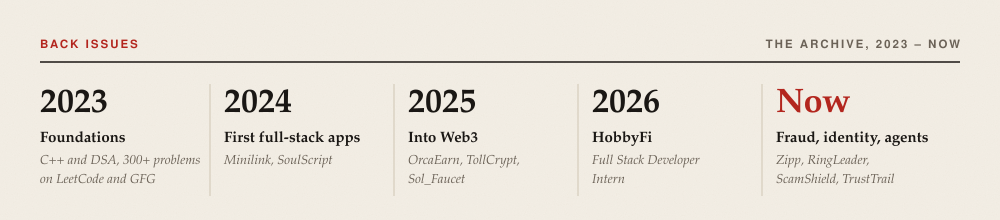
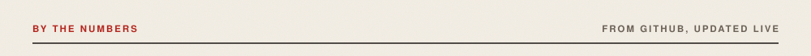
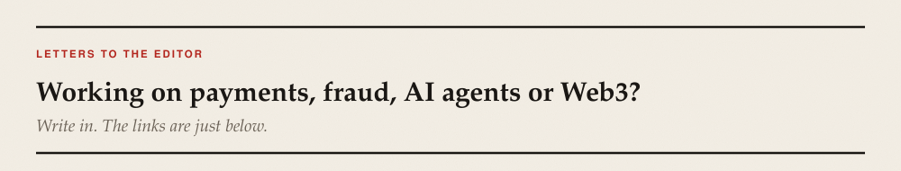

<a href="https://www.vijender.me"><b>Portfolio</b></a> &nbsp;·&nbsp;
<a href="https://drive.google.com/file/d/14bq2wU2y8iiyw4WgjxHer44nFjLG-Nx2/view?usp=sharing"><b>Resume</b></a> &nbsp;·&nbsp;
<a href="https://linkedin.com/in/vijender-yadav-iiit"><b>LinkedIn</b></a> &nbsp;·&nbsp;
<a href="https://twitter.com/vij_yadav_viju_"><b>X</b></a> &nbsp;·&nbsp;
<a href="https://leetcode.com/vij_yadav_viju_"><b>LeetCode</b></a> &nbsp;·&nbsp;
<a href="mailto:ragnarviju2004@gmail.com"><b>Email</b></a>

  

  

<a href="https://ring-leader-bice.vercel.app">RingLeader live demo →</a>

  

  

<a href="https://github.com/desmond009/QueueCTL">QueueCTL repo</a> &nbsp;·&nbsp;
<a href="https://github.com/desmond009/OrcaEarn">OrcaEarn repo</a> &nbsp;·&nbsp;
<a href="https://staking-contract-orca.vercel.app">OrcaEarn live →</a> &nbsp;·&nbsp;
<a href="https://github.com/desmond009?tab=repositories">All repositories →</a>

  

  

  

  

<a href="mailto:ragnarviju2004@gmail.com"><b>ragnarviju2004@gmail.com</b></a> &nbsp;·&nbsp;
<a href="https://linkedin.com/in/vijender-yadav-iiit"><b>LinkedIn</b></a> &nbsp;·&nbsp;
<a href="https://www.vijender.me"><b>vijender.me</b></a>

  

