


  



<a href="https://github.com/desmond009/Zipp"></a>
<a href="https://github.com/desmond009/RingLeader"></a>
<a href="https://github.com/desmond009/Scam-shield"></a>
<a href="https://github.com/desmond009/Trust-Trail"></a>
<a href="https://github.com/desmond009/QueueCTL"></a>
<a href="https://github.com/desmond009/OrcaEarn"></a>

<b>WARP ZONES</b> &nbsp;
<a href="https://ring-leader-bice.vercel.app">RingLeader live</a> ·
<a href="https://staking-contract-orca.vercel.app">OrcaEarn live</a> ·
<a href="https://minilink-phi.vercel.app">Minilink live</a> ·
<a href="https://github.com/desmond009?tab=repositories">all repos</a>

  



 

<a href="mailto:ragnarviju2004@gmail.com"><b>ragnarviju2004@gmail.com</b></a> &nbsp;·&nbsp;
<a href="https://linkedin.com/in/vijender-yadav-iiit"><b>LinkedIn</b></a> &nbsp;·&nbsp;
<a href="https://www.vijender.me"><b>vijender.me</b></a>

  

